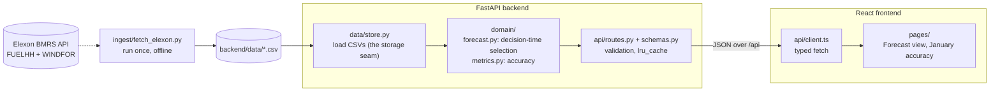
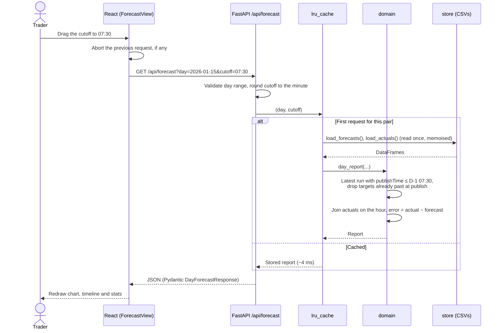
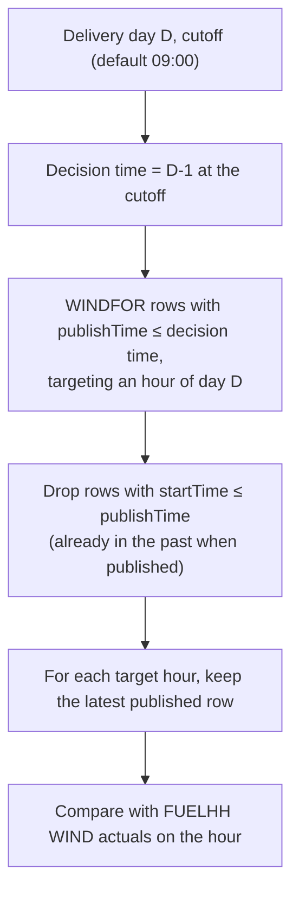
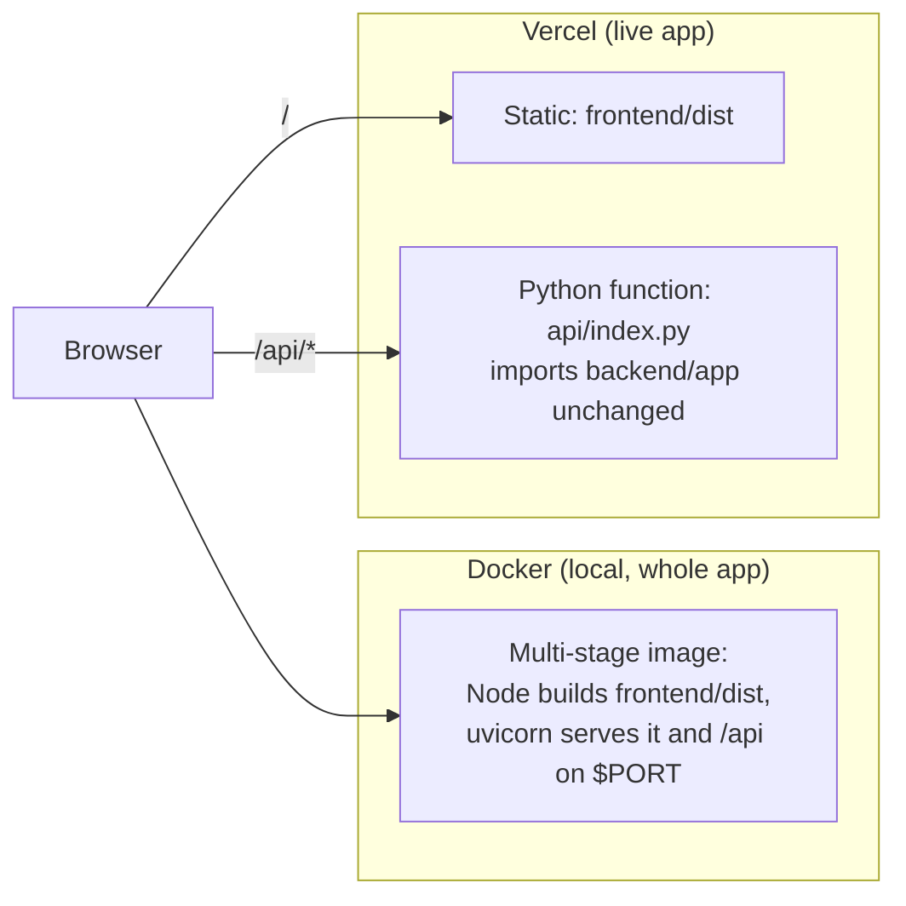

# UK Wind Forecast Monitor

Web app for a UK utility's day-ahead trading team. It shows the national wind generation forecast available at the day-ahead decision time, compares it with actual generation, and measures forecast accuracy, for purchase decisions made in January 2026.

**Live app:** https://ltprw.vercel.app/

## Repository layout

| Path | Contents |
|---|---|
| `backend/app/main.py` | FastAPI app; also serves the built frontend in Docker |
| `backend/app/config.py` | Settings from environment variables (`DATA_DIR`, `STATIC_DIR`, `CORS_ORIGINS`) |
| `backend/app/api/` | HTTP routes |
| `backend/app/domain/` | Pure logic: decision-time forecast selection, accuracy metrics |
| `backend/app/data/` | Loads the pre-ingested CSVs |
| `backend/ingest/fetch_elexon.py` | Fetches FUELHH (WIND) and WINDFOR from Elexon BMRS into `backend/data/` |
| `backend/data/` | Ingested January 2026 data (committed, so the app needs no live API calls) |
| `backend/tests/` | pytest suite |
| `frontend/src/lib/*.test.ts` | Vitest unit tests for the frontend's pure helpers (formatting, chart scales, data merge) |
| `frontend/` | React + TypeScript (Vite) UI |
| `Dockerfile`, `docker-compose.yml` | Single image: builds the frontend, serves it and the API with uvicorn |
| `api/index.py` | Vercel adapter only: Vercel deploys Python functions from a root `api/` folder, so this re-exports `backend/app` unchanged. Not used by Docker or local dev |
| `vercel.json`, `requirements.txt`, `.vercelignore` | Vercel build config; the root `requirements.txt` holds just the runtime dependencies for that function |
| `CLAUDE.md` | Project context for the Claude Code AI assistant |

## Architecture

Data is fetched from Elexon once, offline. At runtime the app reads only the committed CSVs. Each layer depends only on the one below it.



| Layer | Responsibility | Depends on |
|---|---|---|
| `data/store.py` | Load and type the CSVs | Files only |
| `domain/` | Pure functions: pick the forecast known at the cutoff, score it against actuals | pandas only (no HTTP, no files), so it is unit tested directly |
| `api/` | Validate query parameters, cache results, shape responses with Pydantic | `store`, `domain` |
| `frontend/` | Charts, the decision timeline, tables | The JSON API only |

### API

| Endpoint | Returns |
|---|---|
| `GET /api/health` | Status and whether data is loaded |
| `GET /api/meta` | Delivery-day range, default cutoff, regular publish times |
| `GET /api/forecast?day=YYYY-MM-DD&cutoff=HH:MM` | One delivery day: the forecast run used, hourly forecast vs actual, that day's accuracy |
| `GET /api/metrics?cutoff=HH:MM` | Accuracy over all January decisions: summary, buffers, histogram, and breakdowns by day, hours ahead, hour of day and forecast level |

Interactive API docs (Swagger UI) are at http://localhost:8000/docs when running locally or in Docker.

### Request flow

What happens when a trader moves the decision cutoff on the forecast view:



### Decision-time forecast selection

The core rule, in `domain/forecast.py`:



### Deployment

Both paths run the same backend code.



Vercel doesn't run containers, so it builds the frontend natively and runs FastAPI as one serverless function, with the CSVs bundled in. Docker is the reproducible way to run the whole app as one image.

## Running

### Docker (whole app)

```bash
docker compose up --build
# open http://localhost:8000
```

### Local development

Backend (Python 3.12+):

```bash
cd backend
uv venv .venv            # or: python -m venv .venv
uv pip install -r requirements-dev.txt
.venv/Scripts/python -m uvicorn app.main:app --reload   # macOS/Linux: .venv/bin/python
```

Frontend (Node 22):

```bash
cd frontend
npm install
npm run dev              # http://localhost:5173, proxies /api to :8000
```

Refresh the data (optional; the CSVs are already committed):

```bash
cd backend && .venv/Scripts/python -m ingest.fetch_elexon
```

Tests and lint:

```bash
cd backend && .venv/Scripts/python -m pytest && .venv/Scripts/python -m ruff check .
cd frontend && npm run lint && npm test
```

## Data and storage

**Sources** (Elexon BMRS Insights API, public, no key needed):

| Dataset | Used for | Resolution | Rows (Jan 2026 window) |
|---|---|---|---|
| `FUELHH`, `fuelType = WIND` | Actual national wind generation | Half-hourly | 1,536 |
| `WINDFOR` | Wind generation forecast, every published run | Hourly, 8 runs a day | 18,688 |

**Storage:** the brief covers one fixed historical month, about 20k rows (~1 MB). It is fetched once by `ingest/fetch_elexon.py` and committed as CSV in `backend/data/`. That keeps the app fast, free to host, reproducible and free of secrets, and it never calls Elexon at runtime. Because the data is static, API responses are cached in memory.

**One seam:** all data access goes through `backend/app/data/store.py` (`load_actuals()`, `load_forecasts()`). The domain logic, API and frontend never touch files, so changing the store doesn't affect them.

**Path to live data** (not built; out of scope for a fixed January dataset):

1. A scheduled ingest job (cron or GitHub Actions) fetches each new WINDFOR run and FUELHH period incrementally.
2. It upserts them into Postgres (or TimescaleDB), keyed by `(publishTime, startTime)` for forecasts and `startTime` for actuals.
3. `store.py` switches to SQL queries filtered to the requested window. The domain logic, API schemas and UI stay unchanged.
4. Response caching is keyed on the latest ingested `publishTime` instead of being permanent.

## Key assumptions

- The day-ahead decision for delivery day D is made on D-1 at a configurable cutoff (default 09:00 UK time).
- The forecast used is the latest WINDFOR run published at or before that cutoff. Targets already in the past at publish time are ignored.
- "Decisions made in January 2026" covers delivery days 2026-01-02 to 2026-02-01.
- Times are UTC, which equals UK local time throughout January.
- WINDFOR is hourly and FUELHH is half-hourly. Forecasts are compared with actuals on the hour.

## AI tool usage

This project was built with the help of AI coding tools (Claude Code), for research, scaffolding and code generation. All code was reviewed and tested.
